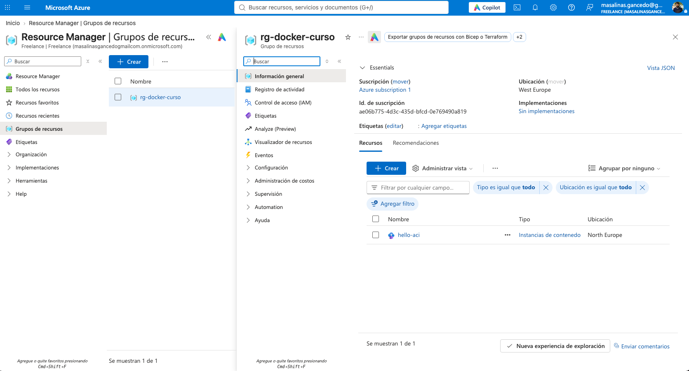
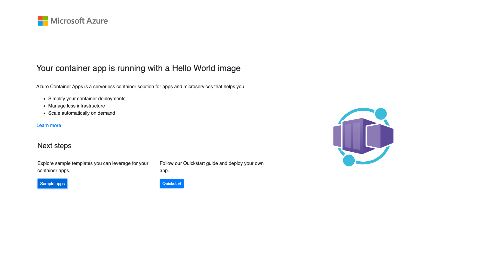

# Description
PoC Docker on Azure Cloud 

## Create Azure Container
```shell
$ az group create --name rg-docker-curso --location westeurope
{
  "id": "/subscriptions/ae06b775-4d3c-435d-bfcd-0e769490a819/resourceGroups/rg-docker-curso",
  "location": "westeurope",
  "managedBy": null,
  "name": "rg-docker-curso",
  "properties": {
    "provisioningState": "Succeeded"
  },
  "tags": null,
  "type": "Microsoft.Resources/resourceGroups"
}

$ az container create \
  --resource-group rg-docker-curso \
  --name hello-aci \
  --location northeurope \
  --os-type Linux \
  --image mcr.microsoft.com/azuredocs/aci-helloworld \
  --dns-name-label hello-aci-training\
  --ports 80 \
  --cpu 1 --memory 1.5
{
  "confidentialComputeProperties": null,
  "containerGroupProfile": null,
  "containers": [
    {
      "command": null,
      "configMap": {
        "keyValuePairs": {}
      },
      "environmentVariables": [],
      "image": "mcr.microsoft.com/azuredocs/aci-helloworld",
      "instanceView": {
        "currentState": {
          "detailStatus": "",
          "exitCode": null,
          "finishTime": null,
          "startTime": "2026-11-07T22:44:20.749000+00:00",
          "state": "Running"
        },
        "events": [
          {
            "count": 1,
            "firstTimestamp": "2026-11-07T22:44:08+00:00",
            "lastTimestamp": "2026-11-07T22:44:08+00:00",
            "message": "pulling image \"mcr.microsoft.com/azuredocs/aci-helloworld@sha256:b9cec4d6b50c6bf25e3f7f93bdc1628e5dca972cf132d38ed8f5bc955bb179c3\"",
            "name": "Pulling",
            "type": "Normal"
          },
          {
            "count": 1,
            "firstTimestamp": "2026-11-07T22:44:13+00:00",
            "lastTimestamp": "2026-11-07T22:44:13+00:00",
            "message": "Successfully pulled image \"mcr.microsoft.com/azuredocs/aci-helloworld@sha256:b9cec4d6b50c6bf25e3f7f93bdc1628e5dca972cf132d38ed8f5bc955bb179c3\"",
            "name": "Pulled",
            "type": "Normal"
          },
          {
            "count": 1,
            "firstTimestamp": "2026-11-07T22:44:20+00:00",
            "lastTimestamp": "2026-11-07T22:44:20+00:00",
            "message": "Started container",
            "name": "Started",
            "type": "Normal"
          }
        ],
        "previousState": null,
        "restartCount": 0
      },
      "livenessProbe": null,
      "name": "hello-aci",
      "ports": [
        {
          "port": 80,
          "protocol": "TCP"
        }
      ],
      "readinessProbe": null,
      "resources": {
        "limits": null,
        "requests": {
          "cpu": 1.0,
          "gpu": null,
          "memoryInGb": 1.5
        }
      },
      "securityContext": null,
      "volumeMounts": null
    }
  ],
  "diagnostics": null,
  "dnsConfig": null,
  "encryptionProperties": null,
  "extensions": null,
  "id": "/subscriptions/ae06b775-4d3c-435d-bfcd-0e769490a819/resourceGroups/rg-docker-curso/providers/Microsoft.ContainerInstance/containerGroups/hello-aci",
  "identity": null,
  "imageRegistryCredentials": null,
  "initContainers": [],
  "instanceView": {
    "events": [],
    "state": "Running"
  },
  "ipAddress": {
    "autoGeneratedDomainNameLabelScope": "Unsecure",
    "dnsNameLabel": "hello-aci-training",
    "fqdn": "hello-aci-training.northeurope.azurecontainer.io",
    "ip": "128.251.124.227",
    "ports": [
      {
        "port": 80,
        "protocol": "TCP"
      }
    ],
    "type": "Public"
  },
  "isCreatedFromStandbyPool": false,
  "location": "northeurope",
  "name": "hello-aci",
  "osType": "Linux",
  "priority": null,
  "provisioningState": "Succeeded",
  "resourceGroup": "rg-docker-curso",
  "restartPolicy": null,
  "sku": "Standard",
  "standbyPoolProfile": null,
  "subnetIds": null,
  "tags": {},
  "type": "Microsoft.ContainerInstance/containerGroups",
  "volumes": null,
  "zones": null
}

$ az container show -g rg-docker-curso -n hello-aci --query ipAddress.fqdn -o tsv
hello-aci-training.northeurope.azurecontainer.io

$ az container logs -g rg-docker-curso -n hello-aci
listening on port 80

$ az container show -g rg-docker-curso -n hello-aci --query instanceView.state -o tsv
Running

$ az group delete --name rg-docker-curso --yes --no-wait
```



## Create Azure Container using Apps

```shell
$ az containerapp up \
  --resource-group rg-docker-curso \
  --name hello-app \
  --location northeurope \
  --image mcr.microsoft.com/k8se/quickstart:latest \
  --target-port 80 \
  --ingress external
Registering resource provider Microsoft.App ...
Using resource group 'rg-docker-curso'
Creating ContainerAppEnvironment 'hello-app-env' in resource group rg-docker-curso
Registering resource provider Microsoft.OperationalInsights ...
No Log Analytics workspace provided.
Generating a Log Analytics workspace with name "workspace-rgdockercurso4pU2"
Creating Containerapp hello-app in resource group rg-docker-curso

Container app created. Access your app at https://hello-app.blackground-ebc3958b.northeurope.azurecontainerapps.io/


Your container app hello-app has been created and deployed! Congrats! 

Browse to your container app at: http://hello-app.blackground-ebc3958b.northeurope.azurecontainerapps.io 

Stream logs for your container with: az containerapp logs show -n hello-app -g rg-docker-curso 

See full output using: az containerapp show -n hello-app -g rg-docker-curso 
```

