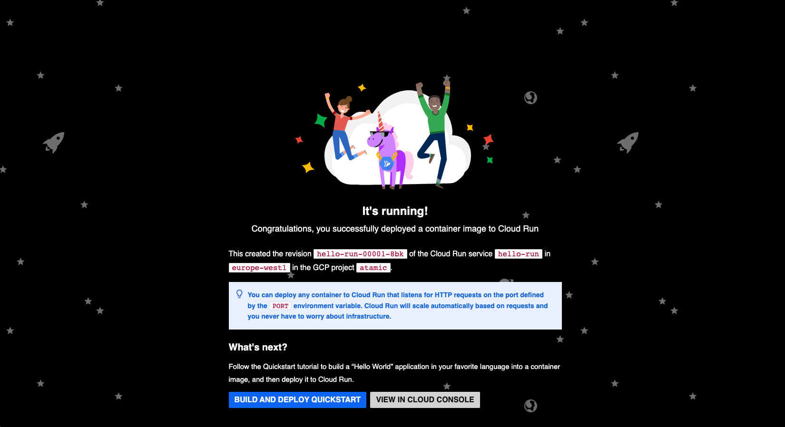
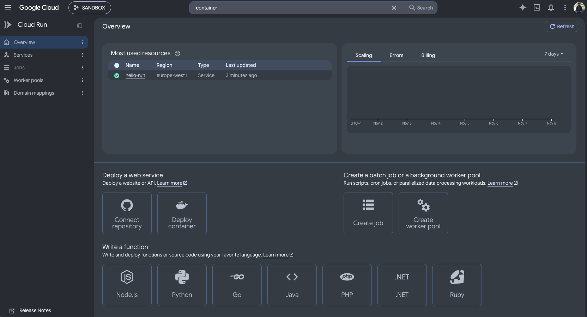

# Description
PoC Docker on GCP Cloud 

## Create GCP Container
```shell
$ gcloud services enable run.googleapis.com artifactregistry.googleapis.com cloudbuild.googleapis.com
Operation "operations/acf.p2-203872501539-2f63a909-32f1-4205-9268-eafc1263c59d" finished successfully.
```

```shell
gcloud run deploy hello-run \
  --image us-docker.pkg.dev/cloudrun/container/hello \
  --region europe-west1 \
  --allow-unauthenticated
Deploying container to Cloud Run service [hello-run] in project [atamic] region [europe-west1]
✓ Deploying new service... Done.                                               
  ✓ Creating Revision...                                                       
  ✓ Routing traffic...                                                         
  ✓ Setting IAM Policy...                                                      
Done.                                                                          
Service [hello-run] revision [hello-run-00001-8bk] has been deployed and is serving 100 percent of traffic.
Service URL: https://hello-run-203872501539.europe-west1.run.app
```

```shell
https://hello-run-203872501539.europe-west1.run.app/
```





Remove all services:
```shell
gcloud run services delete hello-run --region europe-west1
```
